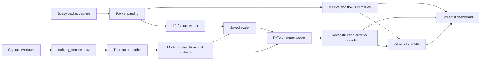

# Threat Analyzer

A Streamlit dashboard for capturing a small live sample of network traffic, summarizing protocols and flows, and flagging behavior that differs from the data used to train a PyTorch autoencoder. It can also generate a plain-language summary using a local Ollama model.

> **Important:** This is an educational/monitoring aid, not an intrusion-prevention system or proof that an attack has occurred. Use packet capture only on networks and devices you own or are authorized to monitor.

## Features

- **Live packet capture:** captures up to 50 packets per dashboard capture using Scapy.
- **Traffic summary:** shows packet count, average payload size, average inter-arrival time, number of protocols, parser-discarded packets, and model threat score.
- **Protocol statistics:** packet counts, traffic share, average payload size, and total bytes by protocol.
- **Top flows:** ranks source/destination IP and port plus protocol by packet and byte counts.
- **Anomaly scoring:** builds a 10-value feature vector, standardizes it with the saved scaler, and compares an autoencoder's reconstruction error with a saved threshold.
- **Natural-language report:** optionally asks Ollama's `llama3.2:1b` model to summarize the captured metrics and flow tables.
- **Dataset and training scripts:** capture feature windows into a CSV and train/update the model artifacts.

## Architecture



### Main components

- `app.py` — Streamlit UI and orchestration of capture, statistics, prediction, and report generation.
- `src/capture.py` — Scapy capture and packet metadata parsing (protocol, addresses, ports, sizes, timestamps).
- `src/stats.py` — basic metrics, protocol breakdowns, and top-flow aggregation.
- `src/ml/features.py` — constructs the model's 10 input features.
- `src/ml/model.py` — defines the encoder/decoder neural network.
- `src/ml/predict.py` — loads the model, scaler, and threshold, then scores a capture.
- `src/ml/build_dataset.py` — records feature vectors for multiple traffic windows.
- `src/ml/train.py` — trains the autoencoder and saves its artifacts.
- `src/llm.py` — sends the summary data to the local Ollama API and handles connection errors.

## Requirements

- Python and package versions compatible with `requirements.txt`.
- Windows users: install **Npcap** for Scapy packet capture. Start VS Code/PowerShell with the permissions required by your Npcap configuration; packet capture may require Administrator privileges.
- Optional, for natural-language reports: install Ollama and download the configured model (`llama3.2:1b`).

## Setup

Run these commands from the project root in PowerShell:

```powershell
py -m venv .venv
.\.venv\Scripts\python.exe -m pip install --upgrade pip
.\.venv\Scripts\python.exe -m pip install -r requirements.txt
```

The virtual environment is machine-specific and should not be committed. Commit `requirements.txt` instead so another device can recreate the Python packages. The installed Python version and platform must be compatible with the pinned packages, especially PyTorch.

## Run the dashboard

From the project root:

```powershell
.\.venv\Scripts\python.exe -m streamlit run app.py
```

Use **Start Live Capture** to capture traffic, then **Generate Report** if Ollama is configured. The capture currently has a packet-count limit of 50 and no timeout, so it can continue waiting if traffic is quiet. Scapy uses its default capture interface; the app currently does not expose an interface selector.

## Optional: build a dataset and train the model

The repository includes the model artifacts used by prediction under `models/`. To create more training samples, run:

```powershell
.\.venv\Scripts\python.exe -m src.ml.build_dataset
```

By default, this captures 30 windows of 50 packets, waits 2 seconds between windows, and appends feature rows to `data/processed/training_features.csv`. Review your capture conditions and the dataset before training. To train and replace the model artifacts:

```powershell
.\.venv\Scripts\python.exe -m src.ml.train
```

Training uses 300 epochs by default and sets the anomaly threshold to the 95th percentile of reconstruction errors on the training data. The training data should represent the traffic you consider normal; contaminated or unrepresentative data can make anomaly scores misleading. Keep the model, scaler, and threshold from the same training run together:

- `models/autoencoder.pt`
- `models/scaler.json`
- `models/threshold.json`

## How the score works

The feature vector contains packet count, average payload size, average inter-arrival time, number of protocols, parser-discarded count, TCP/UDP/ICMP/ARP counts, and L2-only packet count. The predictor normalizes these values with the saved training scaler and calculates mean-squared reconstruction error. An error above the saved threshold is labeled **Anomaly**; otherwise it is labeled **Normal**. The displayed threat score is a relative ratio of error to threshold, capped at 100%, not a calibrated probability of an attack.

The dashboard's **Dropped Packets** value is the count of packets the parser discarded after capture; it is not a measurement of packets dropped by the network interface or operating system.

## Privacy and limitations

- Captured packet metadata is held in the running app's session; this code does not save raw packet captures to disk.
- The optional report includes summary metrics, protocol statistics, and top-flow details (which can include IP addresses and ports). It is sent to the Ollama API at `http://localhost:11434` as configured in `src/llm.py`; it is not a remote cloud endpoint by default.
- The autoencoder detects deviations from its learned feature distribution; it does not inspect payload signatures, identify malware, or confirm a specific threat.
- Results depend on capture volume, network conditions, training data, and model artifacts. Investigate alerts using trusted security tools and context.

## Repository contents

```text
app.py                       Streamlit application
requirements.txt             Pinned Python dependencies
data/processed/              Feature dataset used for training
models/                      Trained model, scaler, and threshold
src/capture.py               Packet capture and parsing
src/stats.py                 Traffic metrics and aggregation
src/llm.py                   Local Ollama report generation
src/ml/                      Feature extraction, model, training, prediction
```
